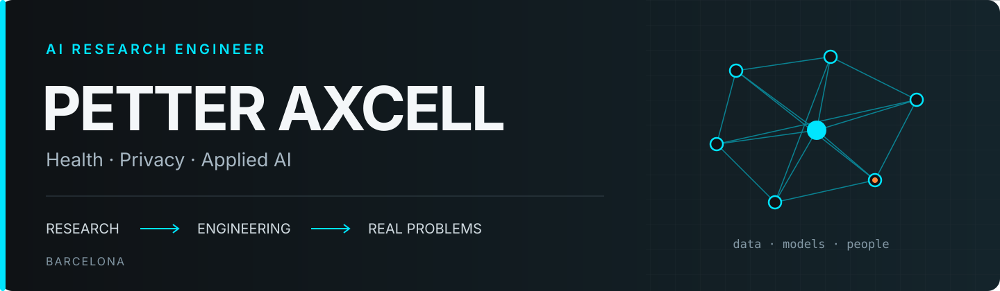

  

  <a href="https://www.linkedin.com/in/petteraxcell/">LinkedIn</a> · <a href="https://orcid.org/0009-0006-9917-9726">ORCID</a> · <a href="docs/portfolio.md">Detailed portfolio</a> · <a href="https://petteraxcell.com">Website</a>

# Hi, I'm Petter

I'm **Petter Axcell Peñafiel Macías**, an AI research engineer at **Hospital Clínic de Barcelona**. I work at the intersection of language models, health data and privacy. I combine applied research, software development and entrepreneurial experience to turn ideas into tools people can use, evaluate and maintain.

My background brings together Computer Science and Telecommunications Systems Engineering. I am currently completing an **MSc in Data Science at UOC**, with graduation expected in December 2026.

## What I work on

- **AI for healthcare:** clinical NLP, information structuring and assistants powered by language models.
- **Data privacy:** text pseudonymisation, tabular anonymisation and evaluation of privacy and utility tradeoffs.
- **LLM systems:** retrieval, agent workflows, tool integration and reproducible evaluation.
- **Software and data engineering:** APIs, web applications, automation, containers and research infrastructure.
- **Teaching and technical communication:** programming, databases and learning materials that explain generative models through papers, diagrams and animations.

## Featured public project

| Project | My contribution and focus | Explore |
| --- | --- | --- |
| **AI and education** | An academic data storytelling project exploring AI adoption, teacher training, digital infrastructure and educational outcomes, with documented sources. | [Code and methodology](https://github.com/PetterAxcell/pr2-equidad-educativa) · [Visualisation](https://petteraxcell.github.io/pr2-equidad-educativa/) |

## Published research

- **Generative AI in a hospital setting.** Coauthor of *Bridging generative AI and healthcare practice*, on Hospital Clínic's GenAI Health Hackathon. **BMJ Health & Care Informatics, 2025.** [Article and authors](https://pubmed.ncbi.nlm.nih.gov/41093629/) · [DOI](https://doi.org/10.1136/bmjhci-2025-101640).
- **High resolution physiological signals.** Coauthor of a surgical ICU dataset published on **PhysioNet, 2026**, supporting signal processing research and algorithm development. [Dataset, authors and access conditions](https://physionet.org/content/barcelona-sicu-signals/1.0.0/) · [DOI](https://doi.org/10.13026/hgz9-s056).

## Experience

| Period | Work |
| --- | --- |
| **2024–present · Hospital Clínic de Barcelona** | AI research engineering: language models, clinical NLP and tools for working with health information. |
| **2023–2025 · Fundació Clínic per a la Recerca Biomèdica** | Research support in privacy, interoperability and health data processing. |
| **2023–2026 · Nordly Arrow** | Cofounder and CEO. Product development, software and AI consulting, and technical leadership. |
| **2022–2023 · IEEC, CVC and Gemweb** | Hyperspectral image compression research, HPC/GPU infrastructure and software development. |

[More about my experience, teaching and approach →](docs/portfolio.md)

## Technologies I work with

| Area | Tools |
| --- | --- |
| **Languages and data** | Python · SQL · TypeScript · JavaScript · PostgreSQL |
| **AI and machine learning** | PyTorch · scikit-learn · language models · NLP |
| **LLM applications** | LangChain · LangGraph · RAG · MCP · Ollama |
| **Software and product** | FastAPI · REST APIs · React · Next.js |
| **Infrastructure** | Docker · Linux · AWS · Git · SLURM |

## Education

- **MSc in Data Science · Universitat Oberta de Catalunya.** In progress; expected completion: December 2026.
- **Bachelor's degree in Computer Science · Universitat Autònoma de Barcelona.** 2018–2023.
- **Bachelor's degree in Telecommunications Systems Engineering · Universitat Autònoma de Barcelona.** 2018–2023.

## How I approach my work

I like following the whole path: understanding the problem, preparing the data, building a solution and checking what works. I value reproducible tests, traceable sources, privacy and clear explanations. My experience building a company also shapes how I think about the people who will use and maintain each tool.

**Barcelona · Applied AI · Healthcare · Privacy · Engineering**

Visit [petteraxcell.com](https://petteraxcell.com) or find me on [LinkedIn](https://www.linkedin.com/in/petteraxcell/).
